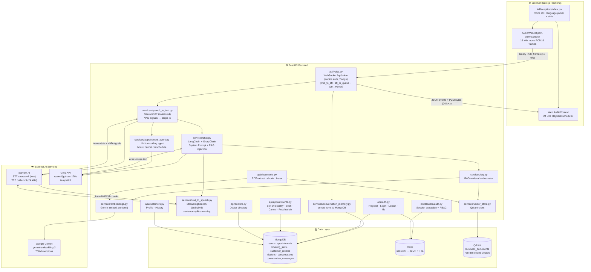

# AI Voice Receptionist

An AI-powered voice receptionist for hospitals and businesses. Handles real-time, multilingual voice conversations (English + 10 Indian languages), answers questions using a Retrieval-Augmented Generation (RAG) system built on indexed business documents, and manages patient appointments through a continuous, hands-free voice interface — plus a full patient portal and admin dashboard.

---

## Table of Contents

1. [Project Overview](#1-project-overview)
2. [Tech Stack](#2-tech-stack)
3. [System Architecture](#3-system-architecture)
4. [Project Structure](#4-project-structure)
5. [Data Models](#5-data-models)
6. [Features and Workflows](#6-features-and-workflows)
7. [Installation and Setup](#7-installation-and-setup)
8. [Environment Variables](#8-environment-variables)
9. [Production Build and Deployment](#9-production-build-and-deployment)
10. [API Reference](#10-api-reference)
11. [Development Guidelines](#11-development-guidelines)

---

## 1. Project Overview

### Purpose

The AI Voice Receptionist replaces a human front-desk receptionist for hospitals and businesses. Callers speak naturally in their preferred language — the system listens continuously, understands context from indexed business documents, and responds with a synthesised voice in real time.

### Key Features

| Feature | Description |
|---|---|
| **Real-time voice conversation** | Continuous microphone streaming (16 kHz PCM16 via AudioWorklet) with sub-second response latency |
| **Multilingual voice** | 11 languages: English, Hindi, Bengali, Tamil, Telugu, Kannada, Malayalam, Marathi, Gujarati, Punjabi, Odia |
| **Barge-in interruption** | Caller can interrupt the AI mid-sentence (Sarvam VAD speech signals) and playback stops immediately |
| **RAG-powered answers** | Responses grounded in indexed business/hospital PDF documents (Qdrant + Gemini embeddings) |
| **Voice appointment agent** | LLM tool-calling agent handles book / cancel / reschedule conversations with a stage-based state machine |
| **Appointment management** | REST endpoints for slot availability, booking, cancellation, rescheduling with slot-conflict prevention |
| **Customer profiles** | Persistent patient profile storage (phone, address, DOB, emergency contact) |
| **Conversation history** | Every voice turn persisted to MongoDB (`conversations` + `conversation_messages`) |
| **Authentication & RBAC** | Session-based auth with `user` and `admin` roles (HttpOnly cookie, Redis-backed) |
| **Patient portal** | Dashboard, live AI receptionist, booking, appointment history, profile, hospital info |
| **Admin dashboard** | Admins manage appointments, doctors, patients, knowledge base, reports, and settings |
| **Document indexing** | Upload PDFs that are chunked, embedded, and stored in a vector database for RAG |

### Application Responsibilities

| Application | Responsibility |
|---|---|
| **Frontend (Next.js)** | Patient portal + admin dashboard, WebSocket voice client, audio capture/playback |
| **Backend (FastAPI)** | API gateway, voice pipeline orchestration, business logic, auth, RAG, appointment agent |
| **MongoDB** | Persistent storage for users, appointments, slots, profiles, doctors, conversations |
| **Redis** | Session storage with TTL-based expiry for stateless, scalable auth |
| **Qdrant** | Vector database for semantic search over indexed business documents |

---

## 2. Tech Stack

### Backend

| Category | Technology | Version / Notes |
|---|---|---|
| **Framework** | FastAPI | `>=0.115.0` |
| **Server** | Uvicorn | `>=0.30.0` — ASGI server with hot reload |
| **Language** | Python | 3.11+ recommended |
| **LLM** | Groq (via LangChain) | `langchain-groq>=1.1.0`, model: `openai/gpt-oss-120b` |
| **LLM Orchestration** | LangChain Core | `langchain-core>=1.0.0` |
| **Speech-to-Text** | Sarvam AI | `sarvamai` SDK — streaming STT, model `saaras:v4`, 16 kHz, VAD signals for barge-in |
| **Text-to-Speech** | Sarvam AI | `sarvamai` SDK — model `bulbul:v3`, speaker `shubh`, linear PCM @ 24 kHz |
| **Embeddings** | Google Gemini | `google-genai`, model: `gemini-embedding-2`, 768 dimensions |
| **Vector Database** | Qdrant | Cloud or self-hosted, cosine similarity |
| **Primary Database** | MongoDB | `pymongo[srv]>=4.8.0` |
| **Cache / Sessions** | Redis | `redis>=5.0.0` async client; falls back to `fakeredis` in dev |
| **Password Hashing** | bcrypt | `>=4.2.0`, 12 rounds |
| **Data Validation** | Pydantic v2 | `>=2.8.0` |
| **PDF Processing** | PyMuPDF | `pymupdf>=1.28.2` |
| **Text Splitting** | LangChain Text Splitters | `langchain-text-splitters>=1.1.3` |
| **HTTP Client** | HTTPX | `>=0.27.0` |
| **WebSockets** | websockets | `>=13.0` |
| **Config** | python-dotenv | `>=1.0.0` |

> **Note:** `requirements.txt` still carries legacy entries (`deepgram-sdk`, `faster-whisper`, `chromadb`) from the previous voice stack. The live pipeline uses `sarvamai` — install it with `pip install sarvamai` if it is missing from your environment.

### Frontend

| Category | Technology | Version / Notes |
|---|---|---|
| **Framework** | Next.js | `16.3.5` (App Router) |
| **Language** | JavaScript (portal) + TypeScript (admin, `lib/`, `types/`) | React 19 |
| **UI Library** | React | `19.2.8` |
| **Styling** | Tailwind CSS | `^4` |
| **Icons** | lucide-react | `^1.79.0` |
| **Charts** | Recharts | `^3.10.1` (admin dashboard) |
| **Audio capture** | Web Audio API + AudioWorklet | `public/pcm-worklet.js` downsamples mic to 16 kHz PCM16 |
| **Audio playback** | Web Audio API | Buffer scheduler for 24 kHz TTS chunks |
| **Transport** | WebSocket (native) | Binary PCM frames + JSON events |

### External Services

| Service | Purpose | Plan |
|---|---|---|
| **Sarvam AI** | Streaming STT + TTS | Pay-as-you-go |
| **Groq** | LLM inference (fast) | Free tier / Pay-as-you-go |
| **Google Gemini** | Text embeddings | Free tier / Pay-as-you-go |
| **Qdrant Cloud** | Managed vector database | Free tier / Managed |

---

## 3. System Architecture



---

## 4. Project Structure

```
ai-voice-receptionist/
│
├── README.MD
│
├── backend/                         # FastAPI Python application
│   ├── main.py                      # App factory, CORS, router registration
│   ├── config.py                    # Environment variable loading (single source of truth)
│   ├── requirements.txt             # Python dependencies (includes legacy Deepgram entries)
│   ├── .env                         # Local secrets (git-ignored)
│   ├── .env.example                 # Template for required variables
│   ├── AUTHENTICATION.md            # Auth module documentation
│   ├── APPOINTMENT_CUSTOMER_MODULE.md # Appointments + customers module documentation
│   │
│   ├── api/                         # Route layer — thin HTTP/WS handlers
│   │   ├── voice.py                 # ★ Core WebSocket voice pipeline (Sarvam STT/TTS, barge-in,
│   │   │                            #   appointment agent, conversation persistence)
│   │   ├── chat.py                  # POST /api/chat — REST text chat
│   │   ├── tts.py                   # POST /api/tts — REST text-to-speech → WAV
│   │   ├── auth.py                  # /api/auth/* — register, login, logout, me
│   │   ├── admin.py                 # /api/admin/* — RBAC-protected admin ops
│   │   ├── appointments.py          # /api/appointments/* — full appointment CRUD
│   │   ├── customers.py             # /api/customers/* — patient profiles & history
│   │   ├── doctors.py               # /api/doctors/* — doctor directory (create/list/fetch)
│   │   └── documents.py             # /api/documents/* — PDF ingestion and RAG indexing
│   │
│   ├── services/                    # Business logic layer — reusable, testable
│   │   ├── chat.py                  # LangChain chain: system prompt + RAG context + Groq
│   │   ├── rag.py                   # RAG orchestrator: embed question → Qdrant search
│   │   ├── embeddings.py            # Gemini embedding-2 client (768-dim)
│   │   ├── vector_store.py          # Qdrant: collection init, upsert, cosine search
│   │   ├── speech_to_text.py        # ★ SarvamSTT: streaming STT (saaras:v4, 16 kHz, VAD)
│   │   ├── text_to_speech.py        # ★ StreamingSpeech: Sarvam TTS (bulbul:v3, 24 kHz)
│   │   ├── appointment_agent.py     # LLM tool-calling appointment flow (state machine)
│   │   ├── appointment_tools.py     # find_doctors / check_doctor_availability tools
│   │   ├── conversation_memory.py   # Persist conversations + messages to MongoDB
│   │   ├── security.py              # bcrypt password hashing + secrets session ID
│   │   └── stt/                     # Legacy local STT artifacts (sravaani model cache)
│   │
│   ├── database/                    # Database connection singletons
│   │   ├── mongodb.py               # MongoClient + users/conversations/messages collections
│   │   ├── redis.py                 # Async Redis client + session CRUD + FakeRedis fallback
│   │   └── __init__.py
│   │
│   ├── middleware/                  # FastAPI dependency functions
│   │   ├── auth.py                  # Session extraction, AuthenticatedUser, RBAC checkers
│   │   └── __init__.py
│   │
│   ├── models/                      # Pydantic request/response schemas
│   │   ├── user.py                  # UserRole, UserRegisterRequest, UserLoginRequest, etc.
│   │   └── __init__.py
│   │
│   ├── scripts/
│   │   ├── create_admin.py          # CLI script to seed first admin account
│   │   └── seed_doctors.py          # CLI script to seed the doctors collection
│   │
│   └── Test/                        # Test scripts + audio fixtures
│       ├── test_auth.py             # Auth + RBAC flow tests
│       ├── test_db.py               # MongoDB connection tests
│       ├── test_embeddings.py       # Gemini embedding tests
│       ├── test_qdrant_connection.py # Qdrant connectivity tests
│       ├── test_rag_chat.py         # End-to-end RAG + chat tests
│       ├── test_appointment_agent.py# Appointment agent tests
│       ├── test_appointment_availability.py / test_availability.py
│       ├── test_doctor_lookup.py    # Doctor directory tests
│       └── test_sarvam.py           # Sarvam STT/TTS connectivity tests
│
└── frontend/                        # Next.js application (portal + admin)
    ├── package.json                 # Next.js 16, React 19, Tailwind 4, lucide-react, recharts
    ├── next.config.mjs
    ├── tsconfig.json                # TypeScript (admin dashboard + lib)
    ├── eslint.config.mjs
    │
    ├── public/
    │   └── pcm-worklet.js           # ★ AudioWorklet: downsample mic → 16 kHz PCM16
    │
    ├── lib/
    │   ├── api.ts                   # API base URL + apiFetch/apiRequest (credentials: include)
    │   ├── mappers.ts                # Backend → UI model mappers
    │   └── navigation.ts             # Admin sidebar navigation
    ├── data/                        # Demo/static datasets for admin pages
    ├── types/                       # Shared TS types (appointment, doctor, reports, ...)
    │
    └── app/
        ├── layout.js                 # Root layout — Geist fonts, full-height body
        ├── page.js                   # Patient portal — tabs (dashboard / AI receptionist / booking / ...)
        ├── globals.css               # Tailwind base + custom animations
        ├── login/page.js             # Login screen
        ├── signup/page.js            # Registration screen
        ├── admin/                    # Admin dashboard (TS)
        │   ├── layout.tsx            # Admin shell (sidebar + header)
        │   ├── page.tsx              # Redirects to /admin/dashboard
        │   └── dashboard|appointments|doctors|patients|
        │       knowledge-base|reports|ai-receptionist|settings/
        └── components/
            ├── AiReceptionistView.jsx # ★ Live voice UI: WS client, mic stream, playback
            ├── AuthProvider.jsx       # Session state (login/logout/useAuth)
            ├── AuthShell.jsx          # Shared login/signup layout
            ├── micPcmStream.js        # startPcmStream(): mic → 16 kHz PCM16 chunks
            ├── Sidebar.jsx            # Patient portal navigation
            ├── DashboardView.jsx      # Portal dashboard
            ├── BookAppointmentView.jsx # Booking flow
            ├── MyAppointmentsView.jsx # Appointment history
            ├── ProfileView.jsx        # Patient profile editor
            ├── HospitalInfoView.jsx   # Static hospital information
            ├── VoiceRecorder.jsx       # Legacy voice UI (superseded by AiReceptionistView)
            └── admin/                 # Admin dashboard components (TSX)
                ├── dashboard|appointments|doctors|patients|
                │   knowledge-base|reports|settings/
                └── ai-receptionist/
```

---

## 5. Data Models

### MongoDB — `users` collection

```json
{
  "_id": "ObjectId",
  "name": "Jane Doe",
  "email": "jane@example.com",
  "password_hash": "$2b$12$...",
  "role": "user | admin"
}
```

| Field | Type | Constraints |
|---|---|---|
| `_id` | ObjectId | Auto-generated |
| `name` | String | 2–100 chars, whitespace-trimmed |
| `email` | String | Valid email, lowercased, **unique index** |
| `password_hash` | String | bcrypt hash (12 rounds) — never plaintext |
| `role` | Enum | `"user"` (default) \| `"admin"` |

---

### MongoDB — `appointments` collection

```json
{
  "appointment_id": "uuid4-string",
  "user_id": "ObjectId-string",
  "customer_name": "Jane Doe",
  "customer_email": "jane@example.com",
  "doctor_id": "DOC001",
  "service": "General Consultation",
  "reason": "Annual checkup",
  "appointment_start": "2026-10-10T09:00:00+00:00",
  "appointment_end": "2026-10-10T09:30:00+00:00",
  "status": "scheduled",
  "created_at": "2026-10-08T12:00:00+00:00",
  "updated_at": null
}
```

| Field | Type | Constraints |
|---|---|---|
| `appointment_id` | String (UUID4) | Application-generated unique ID |
| `user_id` | String | References `users._id` |
| `doctor_id` | String | 1–100 chars |
| `service` | String | 2–150 chars |
| `reason` | String \| null | Max 1000 chars |
| `appointment_start` | ISO 8601 UTC | Must be future, on :00 or :30 boundary |
| `appointment_end` | ISO 8601 UTC | `start + 30 minutes` |
| `status` | Enum | `"scheduled"` \| `"cancelled"` |

---

### MongoDB — `booking_slots` collection

```json
{
  "_id": "DOC001:2026-10-10T09:00:00+00:00",
  "doctor_id": "DOC001",
  "appointment_start": "2026-10-10T09:00:00+00:00"
}
```

The `_id` compound key (`doctor_id:ISO_time`) enforces double-booking prevention atomically via MongoDB's unique `_id` index. A `DuplicateKeyError` on insert signals a conflict.

---

### MongoDB — `customer_profiles` collection

```json
{
  "user_id": "ObjectId-string",
  "phone": "9876543210",
  "address": "123 Main St, City",
  "date_of_birth": "1990-05-20",
  "emergency_contact": "9876500000",
  "created_at": "2026-10-01T10:00:00+00:00",
  "updated_at": "2026-10-08T14:30:00+00:00"
}
```

| Field | Type | Constraints |
|---|---|---|
| `user_id` | String | References `users._id`, upsert key |
| `phone` | String \| null | 7–20 chars |
| `address` | String \| null | Max 300 chars |
| `date_of_birth` | String \| null | `YYYY-MM-DD` format |
| `emergency_contact` | String \| null | Max 100 chars |

---

### MongoDB — `doctors` collection

```json
{
  "doctor_id": "doc-sarah-johnson",
  "name": "Dr. Sarah Johnson",
  "specialization": "General Physician",
  "qualification": "MBBS, MD - General Medicine",
  "experience": 12,
  "available": true,
  "created_at": "2026-10-08T12:00:00+00:00"
}
```

Seeded via `python scripts/seed_doctors.py`. The voice appointment agent uses this directory to match caller requests to doctors.

---

### MongoDB — `conversations` + `conversation_messages`

Every WebSocket voice session creates a conversation record and persists each turn:

```json
// conversations
{
  "_id": "uuid4-string",
  "user_id": "ObjectId-string",
  "status": "active | completed",
  "started_at": "ISODate",
  "ended_at": null
}

// conversation_messages
{
  "conversation_id": "uuid4-string",
  "user_id": "ObjectId-string",
  "role": "user | assistant",
  "content": "…",
  "timestamp": "ISODate"
}
```

Indexes: `conversations.user_id`, `conversation_messages(conversation_id, timestamp)`, `conversation_messages.user_id`.

---

### Redis — Session Store

```
Key:    session:<session_id>
Value:  {"user_id": "...", "role": "user|admin", "email": "...", "name": "..."}
TTL:    SESSION_TTL seconds (default: 3600)
```

Session IDs are generated with `secrets.token_urlsafe(32)` (256-bit entropy).

---

### Qdrant — `business_documents` collection

```json
{
  "id": "uuid4-string",
  "vector": [0.123, -0.456, ...],
  "payload": {
    "text": "The hospital's emergency department operates 24/7...",
    "business_id": "hospital-abc",
    "filename": "hospital-info.pdf",
    "page": 3,
    "chunk_index": 1
  }
}
```

| Field | Type | Notes |
|---|---|---|
| `vector` | float[768] | Gemini `gemini-embedding-2` output |
| `text` | String | Raw chunk text |
| `business_id` | String | Filter key — isolates documents per tenant |
| `filename` | String | Source PDF filename |
| `page` | Int | Page number in source PDF |
| `chunk_index` | Int | Chunk position within the page |

Distance metric: **Cosine similarity**. Chunks are produced by `RecursiveCharacterTextSplitter` (chunk size: 800, overlap: 120).

---

### Pydantic Request/Response Schemas (`models/user.py`)

| Schema | Used In | Fields |
|---|---|---|
| `UserRegisterRequest` | `POST /api/auth/register` | `name`, `email`, `password` |
| `UserLoginRequest` | `POST /api/auth/login` | `email`, `password` |
| `UserResponse` | GET `/api/auth/me` response | `id`, `name`, `email`, `role` |
| `UserRegisterResponse` | Register response | `message`, `user: UserResponse` |
| `AppointmentCreate` | `POST /api/appointments` | `doctor_id`, `service`, `appointment_start`, `reason?` |
| `RescheduleRequest` | `PATCH /appointments/{id}/reschedule` | `new_start` |
| `CustomerProfileUpdate` | `PUT /api/customers/me` | `phone?`, `address?`, `date_of_birth?`, `emergency_contact?` |
| `DoctorCreate` | `POST /api/doctors` | `name`, `specialization`, `experience?`, `available` |

---

## 6. Features and Workflows

### 🎤 Real-Time Multilingual Voice Conversation

```
Browser mic → AudioWorklet (pcm-downsampler) → 16 kHz mono PCM16 frames
    → WebSocket /api/voice?lang=en-IN   (session cookie required)
        │
    └── mic_to_stt task ──────────────────────────→ Sarvam STT (saaras:v4, wss)
                                                          │
                                        transcripts + VAD START/END speech events
    └── stt_to_queue task ← ──────────────────────────────┘
           │  transcript event → push (transcript, language) to asyncio.Queue
           │  START_SPEECH (or transcript while AI talks) → BARGE-IN
           │       └── cancel current_turn_task + send {"type":"interrupt"} to browser
           │
    └── turn_worker task
           │  1. send {"type":"ai_thinking"}
           │  2. if appointment intent → appointment_agent (LLM tool-calling state machine)
           │     else → generate_response(transcript, business_id)
           │       └── RAG: embed question → Qdrant search → inject top-5 chunks
           │       └── Groq: system prompt + RAG context + transcript → AI text
           │  3. persist turn → MongoDB conversation_messages
           │  4. send {"type":"ai_response", "response":"..."}
           │  5. StreamingSpeech.speak(answer) → sentence-split Sarvam TTS (bulbul:v3)
           │       → forward 24 kHz PCM chunks to browser
           │  6. Wait for audio settle time + 400 ms
           │  7. send {"type":"ai_done"}
```

**Language selection:** the UI exposes a language picker persisted in `localStorage`; the chosen code is sent as `?lang=` (e.g. `hi-IN`). The same language drives STT, the LLM reply (via prompt hinting), and the TTS voice. Supported: `en-IN`, `hi-IN`, `bn-IN`, `ta-IN`, `te-IN`, `kn-IN`, `ml-IN`, `mr-IN`, `gu-IN`, `pa-IN`, `od-IN`.

### 📄 Document Indexing (RAG Setup)

```
Admin uploads PDF → POST /api/documents/index (multipart: business_id + file)
    └── PyMuPDF extracts text per page
    └── RecursiveCharacterTextSplitter → chunks (800 chars, 120 overlap)
    └── Gemini embed_content() → 768-dim vectors per chunk
    └── Qdrant upsert with business_id payload filter
```

### 🔐 Authentication Flow

```
Register:  POST /api/auth/register → bcrypt(password) → MongoDB insert (role="user")
Login:     POST /api/auth/login → bcrypt verify → secrets.token_urlsafe(32) → Redis set
           → Set-Cookie: session_id=<token>; HttpOnly; SameSite=lax
Protected: middleware extracts session_id (cookie > Bearer > X-Session-ID header)
           → Redis get → deserialize → AuthenticatedUser context
Voice WS:  cookie read before accept → Redis session lookup
           → missing/invalid session closes the socket with code 1008
Logout:    POST /api/auth/logout → Redis delete session → clear cookie
```

### 📅 Appointment Booking Flow

**Voice path** — `services/appointment_agent.py` drives a stage machine:

```
collecting_details → ready_for_availability → awaiting_doctor_selection
    → awaiting_time_selection → awaiting_confirmation
    (plus awaiting_cancel_* / awaiting_reschedule_* branches)
```

The agent uses LLM tool calls (`find_doctors`, `check_doctor_availability`) and calls the same create/cancel/reschedule records as the REST API.

**REST path:**

```
1. GET /api/appointments/availability?doctor_id=DOC001&appointment_date=2026-10-10
   → Returns available 30-min slots (09:00–17:00) excluding already-reserved slots

2. POST /api/appointments
   Body: { doctor_id, service, appointment_start, reason }
   → Validate UTC time (future, on :00 or :30)
   → booking_slots.insert_one({_id: "DOC001:2026-10-10T09:00:00Z"}) — atomic conflict check
   → appointments.insert_one({...}) — full appointment record
   → Return appointment document

3. PATCH /api/appointments/{id}/cancel
   → Validate status == "scheduled"
   → Update status to "cancelled"
   → booking_slots.delete_one(slot_key) — release the slot

4. PATCH /api/appointments/{id}/reschedule
   → Reserve new slot (conflict check)
   → Release old slot
   → Update appointment_start/end in appointments
```

---

## 7. Installation and Setup

### Prerequisites

- Python 3.11+
- Node.js 20+
- MongoDB (local or Atlas)
- Redis (local or managed — falls back to in-memory FakeRedis if unavailable)
- Qdrant (local Docker or Qdrant Cloud)
- API keys: **Sarvam AI**, **Groq**, **Google Gemini**, **Qdrant**

---

### Backend Setup

```powershell
# 1. Navigate to backend
cd backend

# 2. Create and activate virtual environment
python -m venv venv
.\venv\Scripts\Activate.ps1       # PowerShell (Windows)
# source venv/bin/activate         # bash (Linux/macOS)

# 3. Install dependencies
pip install -r requirements.txt
pip install sarvamai                # Sarvam STT/TTS SDK (voice pipeline)

# 4. Configure environment
copy .env.example .env
# Edit .env with your actual API keys and connection URIs

# 5. Create first admin account
python scripts/create_admin.py --name "Hospital Admin" --email "admin@hospital.com" --password "Admin@123"

# 6. (Optional) Seed the doctors directory
python scripts/seed_doctors.py

# 7. Start the backend
uvicorn main:app --reload --host 0.0.0.0 --port 8000
```

API docs available at: `http://localhost:8000/docs` · Health check: `http://localhost:8000/health`

---

### Frontend Setup

```bash
# 1. Navigate to frontend
cd frontend

# 2. Install dependencies
npm install

# 3. Start the development server
npm run dev
```

Frontend available at: `http://localhost:3000` (patient portal at `/`, admin at `/admin`)

---

## 8. Environment Variables

Create `backend/.env` from `backend/.env.example`:

```env
# ── MongoDB ──────────────────────────────────────────────
MONGO_URI=mongodb://localhost:27017
MONGO_DB_NAME=ai_voice_receptionist

# ── Redis ────────────────────────────────────────────────
REDIS_URL=redis://localhost:6379/0
SESSION_TTL=3600                    # Session lifetime in seconds (default: 1 hour)
SESSION_COOKIE_NAME=session_id
SESSION_COOKIE_SECURE=False         # Set True in production (requires HTTPS)
SESSION_COOKIE_SAMESITE=lax

# ── Sarvam AI (STT + TTS) ───────────────────────────────
SARVAM_API_KEY=your_sarvam_api_key
SARVAM_STT_MODEL=saaras:v4          # Streaming speech-to-text model
SARVAM_TTS_MODEL=bulbul:v3          # Text-to-speech model
SARVAM_TTS_SPEAKER=shubh            # Voice

# ── Groq (LLM) ───────────────────────────────────────────
GROQ_API_KEY=your_groq_api_key
GROQ_MODEL=openai/gpt-oss-120b

# ── Google Gemini (Embeddings) ───────────────────────────
GEMINI_API_KEY=your_gemini_api_key

# ── Qdrant (Vector Store) ────────────────────────────────
QDRANT_URL=https://your-cluster.qdrant.io    # Required — no default
QDRANT_API_KEY=your_qdrant_api_key           # Required — no default
QDRANT_COLLECTION_NAME=business_documents

# ── RAG ──────────────────────────────────────────────────
RAG_DEFAULT_BUSINESS_ID=your-hospital-id    # Used by voice sessions to scope Qdrant search

# ── Legacy (still read by config.py, unused by the voice pipeline) ──
DEEPGRAM_API_KEY=
```

> **Note:** `QDRANT_URL` and `QDRANT_API_KEY` are required at startup — the server will refuse to start if they are missing.

### Optional Frontend Environment

Create `frontend/.env.local` to override defaults:

```env
# REST API base (defaults to http://<hostname>:8000)
NEXT_PUBLIC_API_URL=http://localhost:8000

# Voice WebSocket URL (defaults to ws://<hostname>:8000/api/voice)
NEXT_PUBLIC_VOICE_WS_URL=ws://localhost:8000/api/voice
```

---

## 9. Production Build and Deployment

### Backend

```powershell
# Install production dependencies
pip install -r requirements.txt
pip install sarvamai

# Run with Uvicorn (production: no --reload, multiple workers)
uvicorn main:app --host 0.0.0.0 --port 8000 --workers 4
```

**Production checklist:**

- [ ] Set `SESSION_COOKIE_SECURE=True` (requires HTTPS)
- [ ] Use a managed MongoDB (Atlas) and Redis instance
- [ ] Use Qdrant Cloud or a self-hosted, persistent Qdrant instance
- [ ] Set `GROQ_MODEL` to your desired model
- [ ] Ensure `RAG_DEFAULT_BUSINESS_ID` matches the `business_id` used when indexing documents
- [ ] Place the backend behind a reverse proxy (Nginx, Caddy) with TLS
- [ ] Use a process manager (systemd, PM2, or Docker) to keep uvicorn running
- [ ] Enable CORS only for your production frontend origin in `main.py`

**Update `main.py` CORS for production:**

```python
app.add_middleware(
    CORSMiddleware,
    allow_origins=["https://your-frontend-domain.com"],
    allow_credentials=True,
    allow_methods=["*"],
    allow_headers=["*"],
)
```

---

### Frontend

```bash
# Build for production
npm run build

# Start the production server
npm start
```

**Production checklist:**

- [ ] Set `NEXT_PUBLIC_API_URL` and `NEXT_PUBLIC_VOICE_WS_URL=wss://your-backend-domain.com/api/voice` in `.env.production`
- [ ] Deploy to Vercel, Netlify, or a Node.js server
- [ ] Ensure the backend CORS origin matches the frontend domain

---

### Docker (Optional)

**Backend Dockerfile (example):**

```dockerfile
FROM python:3.11-slim
WORKDIR /app
COPY requirements.txt .
RUN pip install --no-cache-dir -r requirements.txt && pip install sarvamai
COPY . .
CMD ["uvicorn", "main:app", "--host", "0.0.0.0", "--port", "8000", "--workers", "2"]
```

---

## 10. API Reference

### Authentication — `/api/auth`

| Method | Endpoint | Auth | Description |
|---|---|---|---|
| POST | `/api/auth/register` | None | Register a new user (`role="user"` enforced) |
| POST | `/api/auth/login` | None | Login → sets `session_id` HttpOnly cookie |
| POST | `/api/auth/logout` | Session | Invalidate session and clear cookie |
| GET | `/api/auth/me` | Session | Return current user's profile |

### Admin — `/api/admin`

| Method | Endpoint | Auth | Description |
|---|---|---|---|
| GET | `/api/admin/test` | Admin | Verify admin RBAC access |
| POST | `/api/admin/create-admin` | Admin | Create a new admin account |

### Voice & Chat — `/api`

| Method | Endpoint | Auth | Description |
|---|---|---|---|
| WS | `/api/voice?lang=en-IN` | Session cookie | Real-time voice session (closes `1008` without a valid session) |
| POST | `/api/chat` | None | Text chat — body `{ "transcript": "..." }` → `{ "response": "..." }` |
| POST | `/api/tts` | None | Text → WAV audio (REST) |

### Doctors — `/api/doctors`

| Method | Endpoint | Auth | Description |
|---|---|---|---|
| POST | `/api/doctors` | — | Create a doctor (201) |
| GET | `/api/doctors` | — | List doctors |
| GET | `/api/doctors/{doctor_id}` | — | Fetch a single doctor |

### Appointments — `/api/appointments`

| Method | Endpoint | Auth | Description |
|---|---|---|---|
| GET | `/api/appointments/availability` | User | Available 30-min slots for a doctor on a date |
| POST | `/api/appointments` | User | Book a new appointment |
| GET | `/api/appointments/my` | User | My appointments (sorted by date desc) |
| GET | `/api/appointments` | Admin | All appointments |
| GET | `/api/appointments/{id}` | Owner/Admin | Single appointment detail |
| GET | `/api/appointments/{id}/status` | Owner/Admin | Appointment status only |
| PATCH | `/api/appointments/{id}/cancel` | Owner/Admin | Cancel a scheduled appointment |
| PATCH | `/api/appointments/{id}/reschedule` | Owner/Admin | Reschedule to a new time |

### Customers — `/api/customers`

| Method | Endpoint | Auth | Description |
|---|---|---|---|
| GET | `/api/customers/me` | User | My customer profile |
| PUT | `/api/customers/me` | User | Update my profile (upsert) |
| GET | `/api/customers/{id}` | Owner/Admin | Get a customer's profile |
| GET | `/api/customers/{id}/appointments` | Owner/Admin | A customer's appointment history |
| GET | `/api/customers` | Admin | List all customers |

### Documents — `/api/documents`

| Method | Endpoint | Auth | Description |
|---|---|---|---|
| POST | `/api/documents/extract` | None | Extract text from a PDF (page-by-page) |
| POST | `/api/documents/chunk` | None | Extract + chunk a PDF |
| POST | `/api/documents/index` | None | Extract + chunk + embed + store in Qdrant |

### WebSocket Message Protocol (`/api/voice`)

**Server → Browser (JSON):**

| `type` | Payload | Meaning |
|---|---|---|
| `transcript` | `transcript`, `is_final`, `language` | User's final transcript |
| `ai_thinking` | — | Transcript sent to the LLM, awaiting response |
| `ai_response` | `response`, `language` | AI's text response |
| `ai_done` | — | TTS audio fully delivered |
| `interrupt` | — | Stop all queued audio (barge-in) |
| `fallback` | `message` | Degraded response (e.g. turn processing error) |
| `error` | `message` | Fatal session error |

**Server → Browser (Binary):** Raw linear16 PCM audio @ 24 kHz (stream it directly to the Web Audio playback scheduler)

**Browser → Server (Binary):** Raw 16 kHz mono PCM16 frames from the `pcm-downsampler` AudioWorklet (3200-byte / 100 ms frames)

---

## 11. Development Guidelines

### Available Scripts

**Backend:**

```powershell
# Start with hot reload
uvicorn main:app --reload

# Run test scripts
cd backend
python Test/test_auth.py
python Test/test_db.py
python Test/test_embeddings.py
python Test/test_qdrant_connection.py
python Test/test_rag_chat.py
python Test/test_appointment_agent.py
python Test/test_doctor_lookup.py
python Test/test_sarvam.py           # Sarvam STT/TTS connectivity

# Create an admin account
python scripts/create_admin.py --name "Admin" --email "admin@example.com" --password "secure123"

# Seed doctors
python scripts/seed_doctors.py
```

**Frontend:**

```bash
npm run dev       # Start development server (http://localhost:3000)
npm run build     # Production build (webpack)
npm start         # Serve production build
npm run lint      # Run ESLint
```

---

### Adding RBAC Protection to New Endpoints

Import the dependency and add it to your route:

```python
from fastapi import APIRouter, Depends
from middleware.auth import require_authenticated_user, require_admin, AuthenticatedUser

router = APIRouter()

# Any logged-in user OR admin
@router.get("/my-resource")
async def get_resource(user: AuthenticatedUser = Depends(require_authenticated_user)):
    return {"user_id": user.user_id}

# Admin only
@router.get("/admin-resource")
async def admin_only(admin: AuthenticatedUser = Depends(require_admin)):
    return {"role": admin.role}
```

---

### RBAC Response Codes

| Code | Meaning |
|---|---|
| `401 Unauthorized` | No session, invalid token, or expired Redis session |
| `403 Forbidden` | Authenticated but role is insufficient |
| `1008 (WS close)` | Voice WebSocket opened without a valid session cookie |

---

### Indexing Business Documents for RAG

Before voice sessions can answer business-specific questions, index the relevant PDFs:

```bash
curl -X POST http://localhost:8000/api/documents/index \
  -F "business_id=your-hospital-id" \
  -F "file=@hospital-brochure.pdf"
```

Set `RAG_DEFAULT_BUSINESS_ID=your-hospital-id` in `.env` so voice sessions use these documents.

---

### Pre-Production Considerations

- **Requirements hygiene:** remove the legacy `deepgram-sdk` / `faster-whisper` / `chromadb` entries from `requirements.txt` and pin `sarvamai` once the migration is final.
- **Doctor scheduling:** the current slot system uses a fixed 09:00–17:00 grid. Integrate real doctor calendars and service-specific durations before going live.
- **Appointment transactions:** for high-concurrency scenarios, use MongoDB multi-document transactions across `appointments` and `booking_slots`.
- **Document auth:** the `/api/documents/*` endpoints currently have no authentication — restrict them in production to admin-only access.
- **Cancellation policy:** add time-based rules for how close to the appointment time cancellation is allowed.
- **Notifications:** add email/SMS confirmation for bookings, cancellations, and reminders.
- **CORS:** restrict `allow_origins` in `main.py` to your specific production domain.
